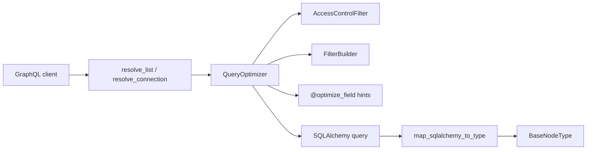

# strawberry-alchemy

Batteries-included toolkit for building **Strawberry GraphQL** APIs backed by
**SQLAlchemy**. It turns the incoming selection set into one optimized query
(defer unrequested columns, `selectinload` nested relations, SQL annotations)
and ships the surrounding cast: filters, Relay pagination, repositories,
row-level ACL, permissions helpers, and input/output mapping.

## What it gives you

| Area | What it does |
|---|---|
| **QueryOptimizer** | Selection set → one SQLAlchemy query: `selectinload`, `defer()`, `EXISTS` / `COUNT` / ancestry CTE annotations |
| **`@optimize_field` hints** | `PrefetchRelated`, `SelectColumns`, `AnnotateExists`, `AnnotateAnyExists`, `AnnotateCount`, `AnnotateCustom`, `AnnotateAncestry` |
| **FilterBuilder** | Strawberry filter inputs → `WHERE`, with `AND` / `OR`, relation joins, `CUSTOM_FILTERS`, JSONB key filters |
| **Types** | `BaseNodeType` (Relay `Node`), `ListResult`, `NestedListResult`, `NodeConfig` / `MaxItems`, `OptimizedListConnection` / `Edge` / `PageInfo` |
| **Repository** | Async CRUD, soft-delete, relation add/remove, `DeletionReport` / cascade handlers |
| **Mapping & schema** | `BaseSchema`, `schema_from_input` / `from_input`, SQLAlchemy → Strawberry mapping |
| **Access control** | `AccessControlFilter` (row ACL), `RelationAccessFilter` (per-edge ACL override) |
| **Permissions** | Auth helpers + `prepare_mutation_resources` for mutation loaders |
| **Postgres RLS** | Session GUC helpers for app-owned `CREATE POLICY` DDL |
| **Models** | `Base` (+ optional `SoftDeleteMixin`) |

## Requirements

- Python `>= 3.13`
- `strawberry-graphql >= 0.339.1`
- `sqlalchemy[asyncio] >= 2.1.6`
- `pydantic >= 2.14`

## Installation

```bash
pip install strawberry-alchemy
# or
uv add strawberry-alchemy
```

## How the pieces fit together



1. Subclass `BaseNodeType`, declare an `access_filter`, and field the columns /
   relationships the client may select.
2. Query resolvers call `resolve_node` / `resolve_list` / `resolve_connection`.
   Those methods read `info`, build one optimized query, apply ACL + filters, and
   map rows back to Strawberry types.
3. Computed fields use `@optimize_field(...)` so the optimizer knows what SQL to
   emit (`EXISTS`, counts, prefetches, …).
4. Mutations use `BaseRepository` + `BaseSchema` / `schema_from_input`, optionally
   with `prepare_mutation_resources` and a `BaseDeletionHandler`.

Walk through a full blog API in [Getting started](getting-started.md). Production
wrapping patterns (project repositories, tenancy, custom order) live in
[Recipes](recipes.md).

## Documentation

- [Getting started](getting-started.md) — models, ACL, types, filters, queries, mutations
- [Blog example](https://github.com/Alteian/strawberry-alchemy/tree/master/examples/blog) — runnable core-pattern sketch
- [Types and models](types-and-models.md)
- [Queries](queries.md)
- [Filtering](filtering.md)
- [Query optimizer](query-optimizer.md)
- [Mapping and schema](mapping-and-schema.md)
- [Repository](repository.md)
- [Permissions](permissions.md)
- [Postgres RLS](postgres-rls.md)
- [Recipes](recipes.md) — production patterns
- [API reference](api-reference.md)
- [Roadmap](roadmap.md)

## Development

```bash
git clone https://github.com/Alteian/strawberry-alchemy.git
cd strawberry-alchemy
mise install
make sync && make doctor
make ci
```

Docs: `make docs` / `make docs-serve`. See [Contributing](https://github.com/Alteian/strawberry-alchemy/blob/master/CONTRIBUTING.md).
